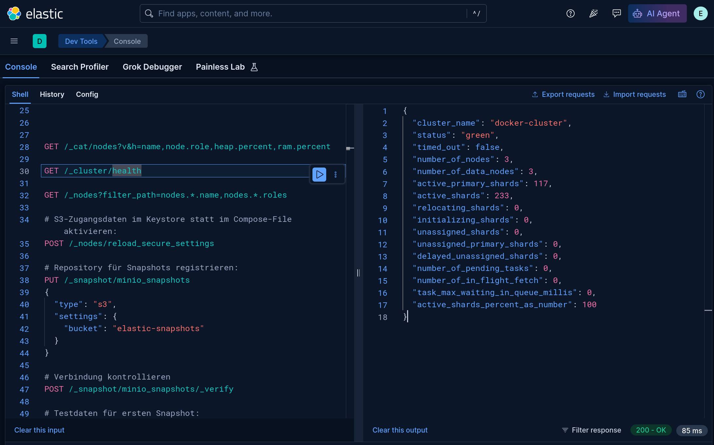
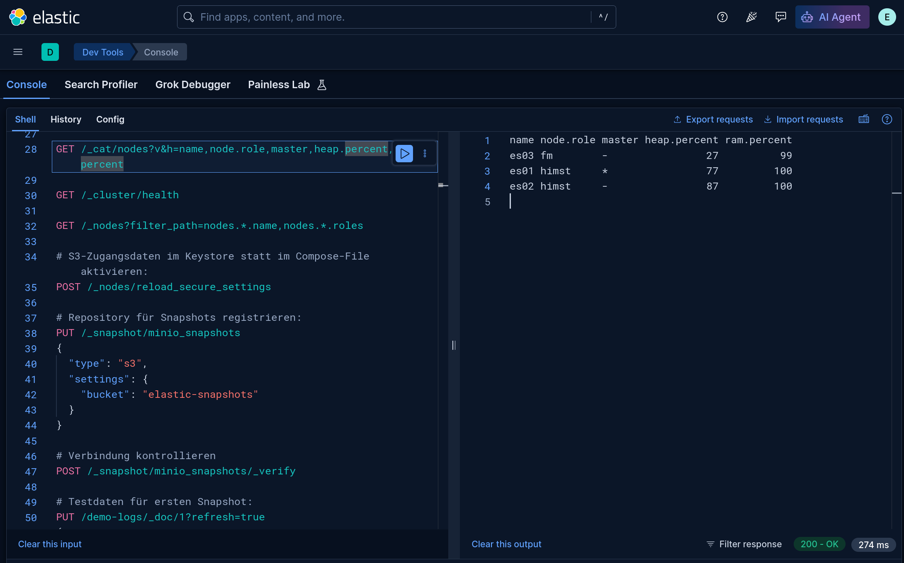
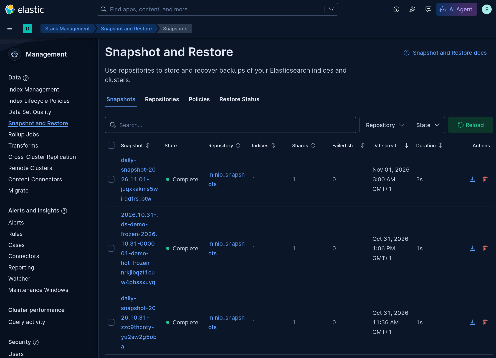
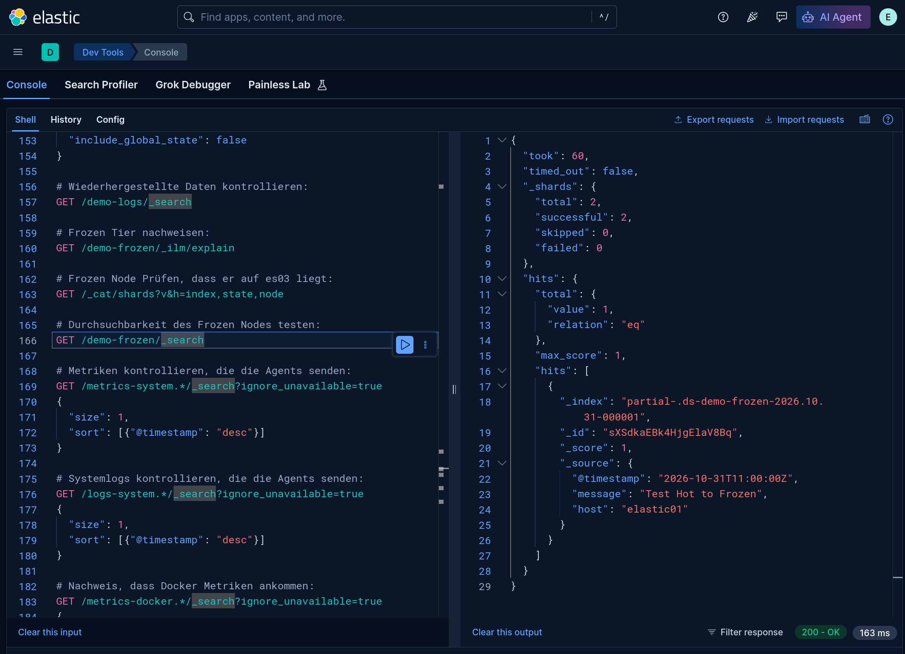
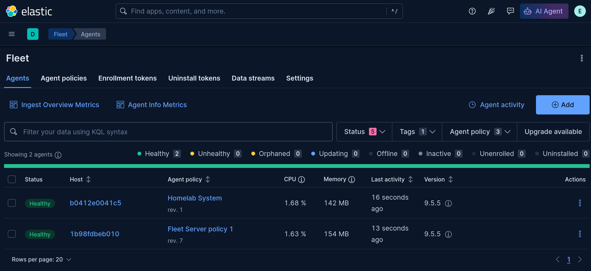
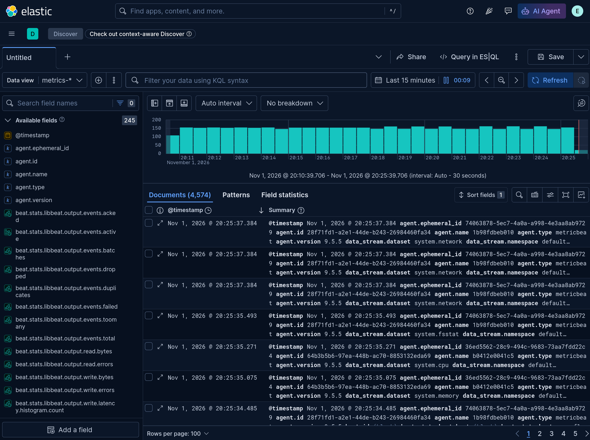

# Elastic Stack Homelab

Elastic Stack Bewerberaufgabe Jan Strähl

Dokumentation der Umsetzung im Homelab. Die Abschnitte folgen der Reihenfolge der Einrichtung: Host und Cluster, MinIO/Snapshots und Lifecycle, Fleet Server/Elastic Agent sowie Fleet-Policy-Änderungen.

## Softwareversionen
- **Elastic Stack:** 9.5.5
- **Docker Engine:** 29.9.2
- **Docker Compose:** v5.6.1

## Hostkonfiguration

### Betriebssystem
- **OS:** Ubuntu Server 26.04.1 LTS
- **Hostname:** elastic01
- **Benutzer:** elastic

### Netzwerkkonfiguration
- **Netzwerk:** VLAN 7 über OPNsense
- **Interface:** eno1
- **IPv4:** 192.168.7.2/24 (statisch)
- **Gateway:** 192.168.7.1 (OPNsense)
- **DNS:** 192.168.7.1 (OPNsense)
- **DNS-Suchdomäne:** elastic.home.arpa

### Hardware und Ressourcen
- **CPU:** Intel Xeon D-2146NT @ 2.30 GHz
- **CPU-Kerne:** 8 Kerne / 16 Threads
- **RAM:** 123 GiB
- **Swap:** 8 GiB
- **SSD:** Samsung 970 EVO Plus 2 TB

### Datenträger und Partitionierung
- **Datenträger:** NVMe SSD (1.8 TiB)
- **/boot:** 2 GiB (ext4)
- **/**: 100 GiB (ext4, LVM)
- **Freier Speicher in LVM:** ca. 1.7 TiB
- **Verschlüsselung:** Keine

### Docker-Konfiguration

Docker CE und das Docker-Compose-Plugin wurden über das offizielle Docker-APT-Repository installiert.

### Host-Vorbereitung

Docker-Installation:

```bash
sudo apt update && sudo apt full-upgrade -y
sudo apt install -y ca-certificates curl git jq openssl nano unzip

sudo install -m 0755 -d /etc/apt/keyrings
sudo curl -fsSL https://download.docker.com/linux/ubuntu/gpg \
  -o /etc/apt/keyrings/docker.asc
sudo chmod a+r /etc/apt/keyrings/docker.asc

sudo tee /etc/apt/sources.list.d/docker.sources > /dev/null <<EOF
Types: deb
URIs: https://download.docker.com/linux/ubuntu
Suites: $(. /etc/os-release && echo "$VERSION_CODENAME")
Components: stable
Signed-By: /etc/apt/keyrings/docker.asc
EOF

sudo apt update
sudo apt install -y docker-ce docker-ce-cli containerd.io \
  docker-buildx-plugin docker-compose-plugin

sudo systemctl enable --now docker
sudo usermod -aG docker elastic
```

Elasticsearch-Host-Einstellung `vm.max_map_count`:

```bash
echo 'vm.max_map_count=1048576' | sudo tee /etc/sysctl.d/99-elasticsearch.conf
sudo sysctl --system
```

Versionen überprüfen:

```bash
docker version
docker --version
docker compose version
```

## Elastic Stack – Installation

### Projekt und Konfiguration

- **Projektverzeichnis:** `/home/elastic/elastic-stack`
- **Ausführung:** Benutzer `elastic`
- **Deployment:** Docker Compose
- **Clustername:** `elastic-lab`
- **Lizenz:** 30-Tage-Trial
- **Security:** TLS und Authentifizierung aktiviert
- **Konfigurationsdateien:** `docker-compose.yml` und `.env`

Die Konfigurationsdateien `docker-compose.yml` und `.env` wurden aus GitLab heruntergeladen und anschliessend per SFTP in das Projektverzeichnis /home/elastic/elastic-stack auf dem Ubuntu-Host übertragen.

Die `.env` enthält unter anderem die Elastic-Stack Version, den Clusternamen und die benötigten Zugangsdaten. Für die Abgabe wird stattdessen eine `.env.example` mit Platzhaltern bereitgestellt, damit keine Zugangsdaten veröffentlicht werden.

### Deployment

Nach der Übertragung der Konfigurationsdateien wurden folgende Befehle auf dem Ubuntu-Host ausgeführt:

```bash
# In das Projektverzeichnis wechseln
cd /home/elastic/elastic-stack

# Compose-Konfiguration prüfen
docker compose config --quiet

# Container starten
docker compose up -d

# Containerstatus prüfen
docker compose ps
```

Der initiale Stack umfasst drei Elasticsearch-Nodes und Kibana. Elasticsearch ist über Port 9200 und Kibana über HTTPS auf Port 5601 erreichbar. Rollen und Clusterstatus sind in Teil 1 dokumentiert.

## Teil 1 – Cluster & Frozen Tier

### 1. Cluster und Kibana

Der Cluster `elastic-lab` wurde mit drei Elasticsearch-Nodes und Kibana eingerichtet. Der Cluster erreichte den Status `green`; die drei Elasticsearch-Container und Kibana waren `healthy`.

| Node | Rollen |
|---|---|
| `es01` | `master`, `data_hot`, `data_content`, `ingest`, `transform` |
| `es02` | `master`, `data_hot`, `data_content`, `ingest`, `transform` |
| `es03` | `master`, `data_frozen` |

**Überprüfung in Kibana Dev Tools:**

```http
GET /_cluster/health
GET /_cat/nodes?v
```

### 2. Shared Cache auf dem Frozen Node

**Konfiguration für `es03` in `docker-compose`:**

```yaml
- xpack.searchable.snapshot.shared_cache.size=2GB
```

Der Shared Cache wurde für die Testumgebung auf **2 GB** begrenzt. Das ursprüngliche Startproblem mit `es03` ist unter **Aufgetretene Probleme und Lösungen** dokumentiert.

## Teil 2 – Snapshots & Lifecycle

### 1. Snapshot-Repository mit MinIO

Als S3-kompatibler Snapshot-Speicher wurde MinIO eingerichtet.

**`docker-compose.yml` Erweiterung:**
- Image: `cgr.dev/chainguard/minio:latest`
- Service: `minio`
- Kommando: `server /data --console-address ":9001"`
- Persistentes Volume: `miniodata:/data`
- Webkonsole: Port 9001
- S3-Endpunkt: `http://minio:9000`
- Bucket: `elastic-snapshots`

**Neue Variablen in `.env`:**
- `MINIO_ROOT_USER`
- `MINIO_ROOT_PASSWORD`

**Elasticsearch-Konfiguration auf es01, es02 und es03:**

```yaml
- s3.client.default.endpoint=http://minio:9000
- s3.client.default.region=us-east-1
- s3.client.default.path_style_access=true
```

Die S3-Zugangsdaten wurden auf allen drei Nodes im Elasticsearch-Keystore hinterlegt:

```text
s3.client.default.access_key
s3.client.default.secret_key
```

Anschliessend wurden die Nodes neu gestartet und die Secure Settings geladen:

```bash
docker compose up -d --no-deps es01 es02 es03
```

```http
POST /_nodes/reload_secure_settings
```

**Snapshot-Repository registrieren:**

```http
PUT /_snapshot/minio_snapshots
{
  "type": "s3",
  "settings": {
    "bucket": "elastic-snapshots"
  }
}
```

**Repository verifizieren:**

```http
POST /_snapshot/minio_snapshots/_verify
```

**Ergebnis:** Repository erfolgreich verifiziert. Alle drei Elasticsearch-Nodes können auf MinIO zugreifen.

### 2. Snapshot Lifecycle Management (SLM)

Eine SLM-Policy erstellt täglich um 02:00 Uhr einen Snapshot und entfernt ältere Snapshots anhand der Retention-Regeln.

```http
PUT /_slm/policy/daily-snapshots
{
  "schedule": "0 0 2 * * ?",
  "name": "<daily-snapshot-{now/d}>",
  "repository": "minio_snapshots",
  "config": {
    "indices": ["demo-logs"],
    "include_global_state": false
  },
  "retention": {
    "expire_after": "7d",
    "min_count": 1,
    "max_count": 7
  }
}
```

**Policy manuell ausführen und überprüfen:**

```http
POST /_slm/policy/daily-snapshots/_execute
GET /_slm/policy/daily-snapshots
GET /_slm/stats
```

**Ergebnis:**
- Policy erfolgreich erstellt
- Snapshot-Ausführung erfolgreich
- `snapshots_taken: 1`
- `failed: 0`
- Retention: 7 Tage, mindestens 1 und maximal 7 Snapshots

### 3. Index Lifecycle Management (ILM)

Eine ILM-Policy wurde erstellt, um Daten automatisch vom Hot Tier in den Frozen Tier zu verschieben.

**Policy: `demo-hot-frozen`**

```http
PUT /_ilm/policy/demo-hot-frozen
{
  "policy": {
    "phases": {
      "hot": {
        "actions": {
          "rollover": {
            "max_age": "10m"
          }
        }
      },
      "frozen": {
        "min_age": "15m",
        "actions": {
          "searchable_snapshot": {
            "snapshot_repository": "minio_snapshots"
          }
        }
      }
    }
  }
}
```

**Konfiguration:**
- Hot Phase: Rollover nach 10 Minuten
- Frozen Phase: Frühestens 15 Minuten nach Rollover
- Snapshot-Repository: `minio_snapshots`
- Searchable Snapshots ermöglichen Suchabfragen auf Daten im Snapshot-Repository.

**Index Template erstellen:**

```http
PUT /_index_template/demo-frozen-template
{
  "index_patterns": ["demo-frozen"],
  "data_stream": {},
  "template": {
    "settings": {
      "index.lifecycle.name": "demo-hot-frozen",
      "number_of_shards": 1
    }
  }
}
```

**Testdaten erzeugen:**

```http
POST /demo-frozen/_doc?refresh=true
{
  "@timestamp": "2026-10-31T10:00:00Z",
  "message": "Test Hot to Frozen",
  "host": "elastic01"
}
```

### 4. Searchable Snapshot auf Frozen Node

**ILM-Status kontrollieren:**

```http
GET /.ds-demo-frozen-2026.10.31-000001/_ilm/explain
```

**Shard-Verteilung prüfen:**

```http
GET /_cat/shards?v&h=index,state,node
```

**Nachweis:**

```text
partial-.ds-demo-frozen-2026.10.31-000001  STARTED  es03
```

Damit ist nachgewiesen:
- ILM hat die Daten erfolgreich vom Hot Tier in den Frozen Tier verschoben.
- Der Index wurde als Searchable Snapshot eingebunden.
- Der Searchable Snapshot liegt auf dem Frozen Node `es03`.
- Der Shard befindet sich im Status `STARTED`.

**Suchabfrage:**

```http
GET /demo-frozen/_search
{
  "query": {
    "match_all": {}
  }
}
```

**Ergebnis:** Die Daten sind auch nach der Verschiebung in den Frozen Tier weiterhin erfolgreich durchsuchbar.


### 5. Snapshot-Restore Test

Ein manueller Snapshot wurde erstellt:

```http
PUT /_snapshot/minio_snapshots/demo-snapshot-01?wait_for_completion=true
{
  "indices": "demo-logs",
  "include_global_state": false
}
```

**Ergebnis:** `SUCCESS`, 0 fehlgeschlagene Shards.

**Index löschen:**

```http
DELETE /demo-logs
```

**Index aus Snapshot wiederherstellen:**

```http
POST /_snapshot/minio_snapshots/demo-snapshot-01/_restore
{
  "indices": "demo-logs",
  "include_global_state": false
}
```

**Wiederhergestellte Daten prüfen:**

```http
GET /demo-logs/_search
{
  "query": {
    "match_all": {}
  }
}
```

**Ergebnis:**
- Snapshot erfolgreich erstellt
- Restore durchgeführt
- Wiederhergestellter Index durchsuchbar
- 1 Testdokument gefunden
- Keine Shard-Fehler

## Teil 3 – Fleet Server & Elastic Agent

### 1. Architektur und Entscheidungen

Fleet Server und Elastic Agent wurden als zusätzliche Docker-Container in das bestehende Compose-Setup integriert.

- **Version:** Elastic Agent 9.5.5
- **Fleet Server:** Docker-Container `fleet-server`
- **Elastic Agent:** Docker-Container `elastic-agent`
- **Verwaltung:** Zentral über Kibana Fleet
- **Verschlüsselung:** HTTPS mit eigener Elastic-CA
- **Fleet Server Port:** 8220
- **Elasticsearch Output:** `https://es01:9200`

Für Fleet Server und Elastic Agent wurden keine zusätzlichen VMs eingerichtet, um die bestehende Infrastruktur wiederzuverwenden und die Komplexität gering zu halten.

### 2. Kibana-Konfiguration

Für Fleet wurde ein dauerhafter Encryption Key eingerichtet.

Schlüssel generieren:

```bash
openssl rand -hex 32
```

Neue Variable in `.env`:

```dotenv
KIBANA_ENCRYPTION_KEY=<GENERIERTER_SCHLUESSEL>
```

Ergänzung in `docker-compose.yml` beim Kibana-Service:

```yaml
- XPACK_ENCRYPTEDSAVEDOBJECTS_ENCRYPTIONKEY=${KIBANA_ENCRYPTION_KEY}
```

Zusätzlich wurde das Speicherlimit für Kibana auf 3 GB erhöht:

```dotenv
KIBANA_MEM_LIMIT=3g
```

```yaml
mem_limit: ${KIBANA_MEM_LIMIT}
```

### 3. TLS-Zertifikat für Fleet Server

Für Fleet Server wurde mit `elasticsearch-certutil` ein eigenes Zertifikat erstellt, das von der bestehenden Elastic-CA signiert wurde.

```bash
docker compose exec -u 0 es01 bash -c '
bin/elasticsearch-certutil cert --silent --pem \
  --ca-cert config/certs/ca/ca.crt \
  --ca-key config/certs/ca/ca.key \
  --name fleet-server \
  --dns fleet-server \
  --ip 192.168.7.2 \
  --out config/certs/fleet-server.zip

unzip -o config/certs/fleet-server.zip -d config/certs/
chmod 750 config/certs/fleet-server
chmod 640 config/certs/fleet-server/*
'
```

**Zertifikatskonfiguration:**
- CA: Bestehende Elastic-CA
- DNS-SAN: `fleet-server`
- IP-SAN: `192.168.7.2`
- Zertifikat: `fleet-server.crt`
- Privater Schlüssel: `fleet-server.key`

### 4. Fleet Server einrichten

In Kibana wurde eine Fleet-Server-Policy `fleet-server-policy` eingerichtet.

Die erforderlichen Service Tokens und Policy-IDs wurden über `.env` bereitgestellt:

```dotenv
FLEET_SERVER_SERVICE_TOKEN=<TOKEN>
FLEET_SERVER_POLICY_ID=<POLICY_ID>
```

**`docker-compose.yml` Erweiterung:**

```yaml
fleet-server:
  image: docker.elastic.co/elastic-agent/elastic-agent:${STACK_VERSION}
  restart: unless-stopped
  user: "0"
  environment:
    - FLEET_SERVER_ENABLE=1
    - FLEET_URL=https://fleet-server:8220
    - FLEET_SERVER_ELASTICSEARCH_HOST=https://es01:9200
    - FLEET_SERVER_SERVICE_TOKEN=${FLEET_SERVER_SERVICE_TOKEN}
    - FLEET_SERVER_POLICY_ID=${FLEET_SERVER_POLICY_ID}
    - FLEET_SERVER_ELASTICSEARCH_CA=/usr/share/elastic-agent/certs/ca/ca.crt
    - FLEET_SERVER_CERT=/usr/share/elastic-agent/certs/fleet-server/fleet-server.crt
    - FLEET_SERVER_CERT_KEY=/usr/share/elastic-agent/certs/fleet-server/fleet-server.key
    - FLEET_CA=/usr/share/elastic-agent/certs/ca/ca.crt
  ports:
    - "8220:8220"
  volumes:
    - certs:/usr/share/elastic-agent/certs:ro
```

**Deployment:**

```bash
docker compose config --quiet
docker compose up -d fleet-server
docker compose ps fleet-server
docker compose logs --tail=80 fleet-server
```

In Kibana wurde anschliessend unter Fleet Settings der Fleet Server Host konfiguriert:

```text
https://192.168.7.2:8220
```

**Ergebnis:** Fleet Server erfolgreich registriert, Status `HEALTHY`.

### 5. Elastic Agent einrichten

In Kibana wurde eine separate Agent Policy `Homelab System` mit der System-Integration erstellt.

Die System-Integration erfasst:
- System-Metriken (CPU, RAM, Datenträger usw.)
- System-Logs

Für den Agent wurde ein Enrollment Token erstellt und in `.env` hinterlegt:

```dotenv
FLEET_AGENT_ENROLLMENT_TOKEN=<TOKEN>
```

**`docker-compose.yml` Erweiterung:**

```yaml
elastic-agent:
  image: docker.elastic.co/elastic-agent/elastic-agent:${STACK_VERSION}
  restart: unless-stopped
  user: "0"
  depends_on:
    - fleet-server
  environment:
    - FLEET_ENROLL=1
    - FLEET_URL=https://fleet-server:8220
    - FLEET_ENROLLMENT_TOKEN=${FLEET_AGENT_ENROLLMENT_TOKEN}
    - FLEET_CA=/usr/share/elastic-agent/certs/ca/ca.crt
    - STATE_PATH=/state
  volumes:
    - certs:/usr/share/elastic-agent/certs:ro
    - agentdata:/state
    - /var/log:/var/log:ro
```

Zusätzliches persistentes Volume:

```yaml
volumes:
  agentdata:
    driver: local
```

Das Hostverzeichnis `/var/log` wurde schreibgeschützt eingebunden, damit der Agent die Systemlogs erfassen kann.

**Deployment und Prüfung:**

```bash
docker compose config --quiet
docker compose up -d elastic-agent
docker compose ps
docker compose logs --tail=80 elastic-agent
```

**Ergebnis:** Elastic Agent erfolgreich in Fleet registriert, Status `HEALTHY`.

### 6. Funktionsprüfung

**Fleet-Status:**
- Fleet Server: `HEALTHY`
- Elastic Agent: `HEALTHY`
- System-Integration: Aktiv

**Detaillierten Status im Fleet-Server-Container abfragen:**

```bash
docker compose exec fleet-server elastic-agent status --output full
```

**Nachweise in Kibana Discover:**

```text
logs-system.*
metrics-system.*
```

**Zusätzliche Prüfung über Dev Tools:**

```http
GET /logs-system.*/_search
{
  "size": 1,
  "sort": [
    {"@timestamp": "desc"}
  ]
}
```

```http
GET /metrics-system.*/_search
{
  "size": 1,
  "sort": [
    {"@timestamp": "desc"}
  ]
}
```

**Ergebnis:**
- Über 10'000 System-Log-Dokumente
- Über 2'600 System-Metrik-Dokumente
- Erfolgreiche Suchabfragen
- Eingehende Daten in Kibana sichtbar

## Teil 4 – Fleet Policy ausrollen

### 1. Zweite Agent Policy erstellen

In Kibana Fleet wurde eine zweite Agent Policy erstellt.

- **Policy:** Homelab Docker
- **Policy-ID:** `homelab-docker`
- **Integration:** Docker
- **Docker Host:** `unix:///var/run/docker.sock`

Die Docker-Integration wurde gewählt, um Container-Metriken über den bestehenden Elastic Agent zu erfassen.

### 2. Docker-Konfiguration anpassen

Damit der Elastic Agent auf die Docker-Metriken zugreifen kann, wurde der Docker Socket in den Agent-Container eingebunden.

**Ergänzung in `docker-compose.yml`:**

```yaml
elastic-agent:
  volumes:
    - /var/run/docker.sock:/var/run/docker.sock:ro
```

Der Socket wurde als Read-only-Bind-Mount eingebunden. Dies verhindert Änderungen an der gemounteten Datei, schränkt jedoch die Berechtigungen der Docker-API nicht ein.

**Container neu erstellen:**

```bash
docker compose up -d --no-deps --force-recreate elastic-agent
```

### 3. Agent Policy zuweisen

Der bestehende Elastic Agent wurde in Kibana Fleet von der bisherigen Policy auf `Homelab Docker` umgestellt.

- **Agent-ID:** `b0412e0041c5`
- **Neue Policy:** Homelab Docker
- **Policy-Revision:** 3
- **Agent-Status:** HEALTHY

Die neue Konfiguration wurde automatisch vom Fleet Server an den Agent verteilt.

Ein manueller Neustart für die Policy-Zuweisung war nicht erforderlich.

### 4. Datenerfassung überprüfen

Die Docker-Integration wurde über Kibana Dev Tools überprüft.

**API-Abfrage:**

```http
GET /metrics-docker.*/_search?ignore_unavailable=true
```

**Ergebnis:**
- 310 Dokumente mit Docker-Metriken nachgewiesen
- Datentyp: `docker.info`
- Agent-Status: HEALTHY
- Daten erfolgreich in Elasticsearch indexiert

Damit ist nachgewiesen, dass die zweite Agent Policy angewendet wurde und die zusätzliche Integration Daten liefert.

### 5. Policy-Änderung und Revision

Zur Überprüfung der zentralen Konfigurationsverwaltung wurde das Logging-Level der Agent Policy angepasst.

**Änderung:**
- Vorher: `info`
- Nachher: `warning`
- Alte Policy-Revision: 3
- Neue Policy-Revision: 4

Die Änderung wurde über die Fleet-Oberfläche durchgeführt.

**Ergebnis:**
- Neue Policy-Revision automatisch erstellt
- Revision 4 vom Agent übernommen
- Agent weiterhin HEALTHY
- Kein Container-Neustart erforderlich

Damit wurde die dynamische Konfigurationsverteilung über Fleet erfolgreich nachgewiesen.

### 6. Policy as Code (Bonus)

Die optionale Umsetzung über Fleet API oder Terraform wurde aus Zeitgründen nicht durchgeführt.

## Teil 5 – Konfiguration & Abfragen

Die Antworten auf die Konfigurationsfragen, die API-Abfragen und deren Ergebnisse sind in der separaten Datei `ANTWORTEN.md` dokumentiert.

## Nachweise

Die wichtigsten Ergebnisse der Implementierung sind nachfolgend mit Screenshots dokumentiert. Weitere technische Prüfungen und API-Ausgaben befinden sich in den jeweiligen Dokumentationsteilen.

### Teil 1 – Elasticsearch-Cluster

**Clusterstatus:** Der Elasticsearch-Cluster erreicht den Status `green` und umfasst drei Nodes.



**Node-Rollen:** Übersicht der drei Elasticsearch-Nodes mit ihren zugewiesenen Rollen.



### Teil 2 – Snapshots und Frozen Tier

**Snapshots:** Erfolgreich erstellte Snapshots im MinIO-Snapshot-Repository.



**Searchable Snapshot:** Erfolgreiche Suchabfrage auf einem Frozen-Index.



### Teil 3 – Fleet Server und Elastic Agent

**Fleet:** Fleet Server und Elastic Agent sind erfolgreich registriert und melden den Status `Healthy`.



**System-Metriken:** Kontinuierlich eingehende System-Metriken in Kibana Discover.



### Weitere Nachweise

Die Konfiguration der Lifecycle-Policies, der Restore-Test, die Verteilung von Fleet Policies sowie die Abfragen der Elasticsearch-Einstellungen sind in den jeweiligen Dokumentationsteilen mit Befehlen und Ergebnissen beschrieben.

## Aufgetretene Probleme und Lösungen

### 1. Frozen Node – Shared Cache

**Problem:** Beim ersten Start mit der Rolle `data_frozen` konnte `es03` aufgrund einer zu grossen automatisch berechneten Shared-Cache-Anforderung nicht starten.

**Lösung:** Der Shared Cache wurde in Docker Compose auf 2 GB begrenzt. Die Konfiguration steht in Teil 1; die Begründung in `ANTWORTEN.md`.

**Ergebnis:** `es03` startete mit der Rolle `data_frozen` und wurde Teil des `green`-Clusters.

### 2. Kibana – Out of Memory

**Problem:** Kibana startete nicht zuverlässig. In den Logs erschien ein Node.js-Heap-Fehler (`heap out of memory`).

**Lösung:**
- Speicherlimit für Kibana auf 3 GB erhöht.
- Container neu erstellt.

```bash
docker compose up -d --no-deps --force-recreate kibana
```

**Ergebnis:** Kibana lief wieder stabil.

### 3. Fleet Server – Enrollment fehlgeschlagen

**Problem:** Fleet Server konnte sich nicht registrieren.

Fehlermeldung:

```text
Error: url is required when a certificate is provided
```

**Lösung:** Folgende Umgebungsvariable in Docker Compose ergänzt:

```yaml
- FLEET_URL=https://fleet-server:8220
```

Anschliessend Fleet Server neu erstellt.

**Ergebnis:** Fleet Server wurde erfolgreich registriert.

### 4. Falscher Elasticsearch Output

**Problem:** Der Elasticsearch Output verwendete zunächst `127.0.0.1:9200`. Innerhalb eines Containers verweist diese Adresse auf den jeweiligen Container selbst.

**Lösung:** Elasticsearch Output in Kibana Fleet korrigiert:

```text
https://es01:9200
```

Damit erfolgt die Kommunikation über das interne Docker-Netzwerk.

### 5. TLS – Unbekannte Zertifizierungsstelle

**Problem:** Fleet Server war `HEALTHY`, die verbundenen Komponenten zeigten jedoch teilweise `DEGRADED`.

Fehlermeldung:

```text
x509: certificate signed by unknown authority
```

**Ursache:** Die Elasticsearch-CA war im Fleet Output nicht korrekt als vertrauenswürdig konfiguriert.

**Lösung:** CA-Datei im Elasticsearch Output von Fleet hinterlegt:

```text
/usr/share/elastic-agent/certs/ca/ca.crt
```

Die fehlerhafte zusätzliche Advanced-Konfiguration wurde entfernt.

**Ergebnis:** Zertifikatsprüfung funktionierte und die Komponenten erreichten `HEALTHY`.

### 6. Veraltete Agent-Registrierungen

**Problem:** Nach dem Neuerstellen des Elastic-Agent-Containers erschienen in Fleet zwei zusätzliche Agents mit dem Status `OFFLINE`.

**Betroffene Agent-IDs:**
- `96a31b2c807b`
- `25cfe16617a2`

**Vermutete Ursache:** Durch das Neuerstellen des Containers wurden neue Agent-Registrierungen erzeugt. Die bisherigen Registrierungen blieben in Fleet bestehen.

**Lösung:** Der aktive Agent wurde anhand seiner Agent-ID identifiziert und erfolgreich der Policy `Homelab Docker` zugewiesen.

Die Bereinigung der veralteten Offline-Einträge wurde nicht durchgeführt, da diese den Betrieb nicht beeinträchtigten.

**Ergebnis:** Der aktive Agent war HEALTHY und lieferte erfolgreich Docker-Metriken.

## Was ich in Produktion anders machen würde

Aus Zeitgründen wurden folgende Sicherheitsmassnahmen in dieser Testumgebung nicht umgesetzt:

- Separate Service-Benutzer für die einzelnen Instanzen und Container nach dem Least-Privilege-Prinzip.
- Restriktive Datei- und Verzeichnisberechtigungen mit passenden Besitzern für jeden Dienst.
- Verschlüsselung der Datenträger (z. B. LUKS).
- SSH-Zugriff ausschliesslich über SSH-Schlüssel statt Passwortauthentifizierung.
- HTTPS für Weboberflächen: Die Weboberflächen von Kibana und MinIO konsequent über HTTPS mit gültigen TLS-Zertifikaten absichern.
- Zentrale Zertifikatsverwaltung: Die bereits verwendete interne Certificate Authority (CA) für alle Komponenten einsetzen, Zertifikate zentral signieren und deren Erneuerung verwalten.
- DNS statt IP-Adressen: Für die Dienste eindeutige Hostnamen verwenden und entsprechende DNS-Einträge auf dem DNS-Server konfigurieren. Die Hostnamen müssen auch in den TLS-Zertifikaten hinterlegt sein.
- Mutual TLS (mTLS): Die Kommunikation zwischen Elastic Agents und Fleet Server zusätzlich durch gegenseitige Zertifikatsauthentifizierung absichern. Dabei muss sich nicht nur der Fleet Server gegenüber dem Agent, sondern auch der Agent mit einem gültigen Client-Zertifikat gegenüber dem Fleet Server authentifizieren.
- Separate Administrationsbenutzer: Für die Administration des Linux-Servers persönliches Benutzerkonto mit gezielt vergebenen sudo-Berechtigungen verwenden.

- Docker-Ressourcen: RAM-Limits und gegebenenfalls CPU-Limits der einzelnen Container anhand des tatsächlichen Ressourcenverbrauchs und der erwarteten Last dimensionieren.
- Frozen Tier Shared Cache: Die Grösse des Shared Cache abhängig von Datenvolumen, Suchhäufigkeit und verfügbarem SSD-Speicher festlegen, statt einen festen Wert von 2 GB zu verwenden.

In einer produktiven Umgebung würde ich diese Massnahmen zur Verbesserung der Performance und Systemsicherheit umsetzen.

## Verwendete Anleitungen und Quellen
### Grundlage
- [Docker: Installation auf Ubuntu](https://docs.docker.com/engine/install/ubuntu/)

### Teil 1
- [Elastic: Docker Compose Installation](https://www.elastic.co/docs/deploy-manage/deploy/self-managed/install-elasticsearch-docker-compose)
- [Elastic: docker-compose.yml zum beginnen](https://github.com/elastic/elasticsearch/blob/main/docs/reference/setup/install/docker/docker-compose.yml)
- [Elastic: .env zum beginnen](https://github.com/elastic/elasticsearch/blob/main/docs/reference/setup/install/docker/.env)
- [Elastic: Konfiguration und die Rollen der Nodes](https://www.elastic.co/docs/deploy-manage/distributed-architecture/clusters-nodes-shards/node-roles)

### Teil 2
- [Red Hat: Hinweis zur MinIO Verfügbarkeit](https://access.redhat.com/solutions/7148629)
- [Chainguard: MinIO Image und Bereitstellung des S3-kompatiblen Snapshot-Speichers](https://images.chainguard.dev/directory/image/minio/overview)
- [Elastic: Verbindung zu MinIO, S3-Konfiguration und Keystore-Zugangsdaten](https://www.elastic.co/docs/deploy-manage/tools/snapshot-and-restore/s3-repository)
- [Elastic: Automatische tägliche Snapshots und 7 Tage Aufbewahrung](https://www.elastic.co/docs/api/doc/elasticsearch/operation/operation-slm-put-lifecycle)
- [Elastic: Verschiebung von Hot nach Frozen mittels Searchable Snapshots](https://www.elastic.co/docs/reference/elasticsearch/index-lifecycle-actions/ilm-searchable-snapshot)

### Teil 3
- [Elastic: Bereitstellung von Fleet Server und Elastic Agent](https://www.elastic.co/docs/reference/fleet/elastic-agent-container)
- [Elastic: Konfiguration von Enrollment Token, Service Token und Fleet-URLs](https://www.elastic.co/docs/reference/fleet/agent-environment-variables)
- [Elastic: TLS-Zertifikate, CA-Vertrauenskette und verschlüsselte Kommunikation](https://www.elastic.co/docs/reference/fleet/secure-connections)
- [Elastic: Konfiguration des Kibana Encryption Keys für Fleet](https://www.elastic.co/docs/reference/kibana/configuration-reference/security-settings)

### Teil 4
- [Elastic: Erstellen, Zuweisen und Aktualisieren der Agent Policy Homelab Docker](https://www.elastic.co/docs/reference/fleet/agent-policy)
